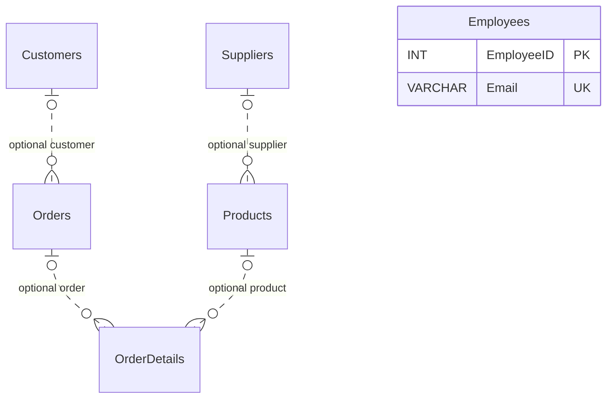

# Relational order-management database

**Author:** [Neer-1](https://github.com/Neer-1)

A university Database Principles schema transcribed from the submitted report, with subsequent synthetic examples and reproducible validation. The fictional ShopGadgetsOnlinePlace domain covers customers, suppliers, products, orders, order details and employees. This is a database-design exercise, not a complete shop or production-ready system. No affiliation with a real business is implied.

## Coursework scope and implementation

The coursework required an order-management business model, documented tables/attributes/constraints, one-to-many and many-to-many relationships, test data and SQL export. Its query requirements included comparison/logical/special operators, sorting, COUNT/SUM/AVG/MIN/MAX, LEFT/RIGHT/INNER JOIN, updates and deletes. This repository covers the database exercise; the separate theory question and university documents are excluded.

`schema.sql` retains the previously staged report-derived DDL unchanged. `seed.sql`, `queries.sql` and `validate.py` are new portfolio additions prepared with Codex assistance. They are not original submitted SQL or exact report outputs. See [PROVENANCE.md](PROVENANCE.md) for evidence and corrections.

## Setup and validation

Validated on Windows with MySQL Community Server **8.0.45** and Python **3.12.3**. Requires an already-installed, trusted MySQL 8.0 server/client pair and Python 3 standard library only. No Python packages, downloads, existing service, account or database are needed. MariaDB, Linux/macOS, other MySQL versions and concurrent workloads are untested.

From the repository folder, create an output directory outside it and run:

```powershell
New-Item -ItemType Directory -Force ..\a06-validation-output | Out-Null
python -B validate.py --mysql-bin "C:\Program Files\MySQL\MySQL Server 8.0\bin" --work-dir ..\a06-validation-output
```

The runner creates a new uniquely named data directory and shared-memory channel, initializes an empty disposable server, disables TCP and MySQL X, uses InnoDB and utf8mb4_0900_ai_ci, and applies strict SQL mode to test sessions. It ignores normal MySQL option/login files and inherited MYSQL_PWD. It cannot select an existing server via host/port options. The temporary instance has no root password: it is for isolated local synthetic testing only, not shared-machine or production deployment. No service is installed.

The runner imports `schema.sql`, then `seed.sql`, executes the labelled examples in `queries.sql`, validates constraints/limitations, drops the schema, repeats fresh setup, drops it again and shuts down the instance. Output includes a uniquely named directory containing `results.json` and server logs. Data-directory files are retained there for review; they are outside the public repository. After confirming the server is stopped, that specific disposable output directory may be removed manually.

Do not import these scripts into a personal/live database. The schema deliberately uses plain CREATE DATABASE and is not an in-place migration: repeating it against an existing database fails rather than silently changing it. Seed replay also rejects duplicate IDs. Repeatability means a fresh instance or an explicit disposable reset, which the runner tests.

## Tables, data types and constraints

Each table has one signed INT AUTO_INCREMENT primary key: CustomerID, SupplierID, ProductID, OrderID, OrderDetailID and EmployeeID respectively. Primary keys are unique and non-null. All **25 other columns are nullable**.

| Table | Other columns and types | Additional enforced constraints |
| --- | --- | --- |
| Customers | FirstName, LastName, Email, Password: VARCHAR(255); Phone: VARCHAR(20) | UNIQUE Email |
| Suppliers | Name, ContactName: VARCHAR(255); Phone: VARCHAR(20) | None |
| Products | Name: VARCHAR(255); Description: TEXT; Price: DECIMAL(10,2); StockQuantity, SupplierID: INT | SupplierID references Suppliers |
| Orders | CustomerID: INT; OrderDate: DATETIME; Status: VARCHAR(50) | CustomerID references Customers |
| OrderDetails | OrderID, ProductID, Quantity: INT; Price: DECIMAL(10,2) | OrderID references Orders; ProductID references Products |
| Employees | FirstName, LastName, Email: VARCHAR(255); Department, Role: VARCHAR(100) | UNIQUE Email |

Email uniqueness is per table, allows multiple NULLs and is case-insensitive under the tested collation. Employees are not linked to orders in the DDL. The four foreign keys reject nonexistent non-null parents; their default ON UPDATE/ON DELETE metadata is NO ACTION, behaving as immediate restriction in the tested InnoDB instance. No cascade was added. Primary/unique/FK-supporting indexes are supplied by MySQL; no additional performance tuning is claimed.



This is a relationship overview; the table above is the full attribute dictionary. Optional parent cardinality reflects nullable foreign keys, not a business recommendation. Orders and Products have a many-to-many association through OrderDetails when both links are populated. There is no UNIQUE(OrderID, ProductID), so repeated product lines within an order are allowed.

## Synthetic examples and expected results

Fixtures use synthetic names and reserved example.invalid email addresses. Password/phone fields are not populated. Three customers, three suppliers, four products, three orders, three detail rows and one employee are inserted. An unused supplier, product without supplier and order without detail rows make outer-join behavior visible.

`queries.sql` records machine-readable expected results next to each query; `validate.py` executes those same statements and checks exact rows. All comparisons are against this new fixture, not report screenshots.

| Example | Expected result |
| --- | --- |
| Comparison/logical/IN/LIKE filter | Product IDs 1, 2 |
| Customer ordering | IDs 1, 2, 3 |
| Aggregates | 3 orders; detail-value sum 55.00; mean product price 11.875000; min 0.00; max 25.00 |
| LEFT JOIN | All four products, including product 4 with NULL supplier |
| RIGHT JOIN | All three suppliers, including supplier 3 with NULL product |
| INNER JOIN | Orders 1,2 map to customer 1; order 3 maps to customer 2 |
| Per-order totals | 35.00, 20.00, 0.00 |
| Conditional update | Product 2 stock temporarily becomes 11 |
| Cancelled-order deletion | Order 3 temporarily removed; IDs 1,2 remain |

UPDATE and DELETE examples are wrapped in transactions and rolled back. The cancelled example order has no dependent lines; deleting a referenced order is correctly rejected. Detail-value sum is not verified revenue or payment accounting.

## Actual validation and known limitations

**72 checks passed** on the release candidate. Fresh creation, repeatable fresh setup, table/column/constraint metadata, valid inserts, all four orphan-FK insert/update failures, referenced-parent delete/update restrictions, duplicate primary keys/emails, nullable fields, value boundaries, all nine query examples and cleanup were exercised. Schema deletion and graceful server exit succeeded; no A06 server process remained.

Accepted gaps are deliberately tested and disclosed:

- NULL relationships and omitted OrderID are accepted; the DDL does not enforce a complete order graph.
- Negative prices, stock and quantities are accepted. Zero values are also accepted. No non-negative CHECK constraints appear in the report-derived DDL.
- Duplicate order/product pairs and arbitrary order-status strings are accepted. Currency, mandatory fields, allowable statuses and employee/order links are unspecified.
- DECIMAL(10,2) ranges from -99999999.99 to 99999999.99; INT boundary tests use -2147483648 to 2147483647. Overflow is rejected in the tested strict mode; 1.235 becomes 1.24 in the price column. SQL modes/collations can change behavior.
- No triggers, stored procedures, stock-reservation logic, shipping/payment/refund workflow, authentication, permissions system or concurrency guarantee is supplied.

No new NOT NULL, CHECK, status enumeration, unique order-line pair or cascading rule was invented. A production redesign would need explicit business decisions first. The retained Password column is report provenance, not a secure authentication implementation: no password hashes or real credentials are bundled, and the fixtures leave it NULL.

## Attribution and license

The author confirms individual ownership of the original work, no original collaborators and permission to publish coursework-derived SQL. Inspection found no embedded third-party implementation notices, external SQL libraries or distributed vendor code. Conventional SQL syntax alone cannot establish provenance; any later-discovered copied material must be reviewed before publication. MySQL and Python are prerequisites, not bundled software.

License undecided; no open-source license or LICENSE file is included.
